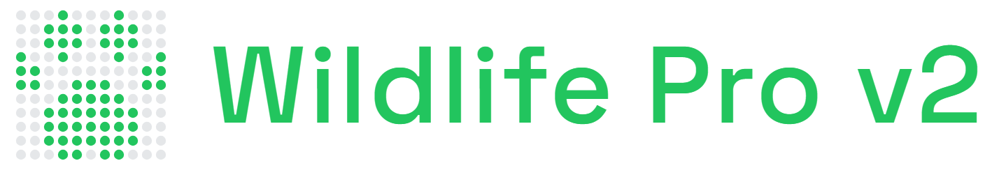
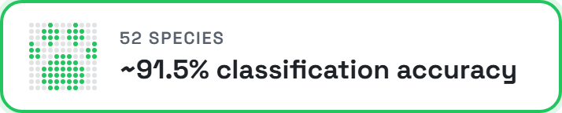
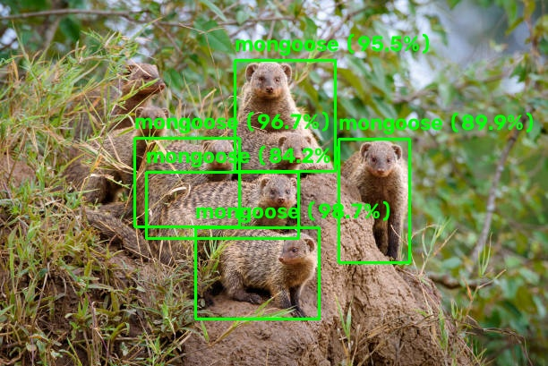
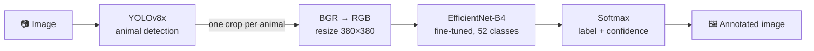
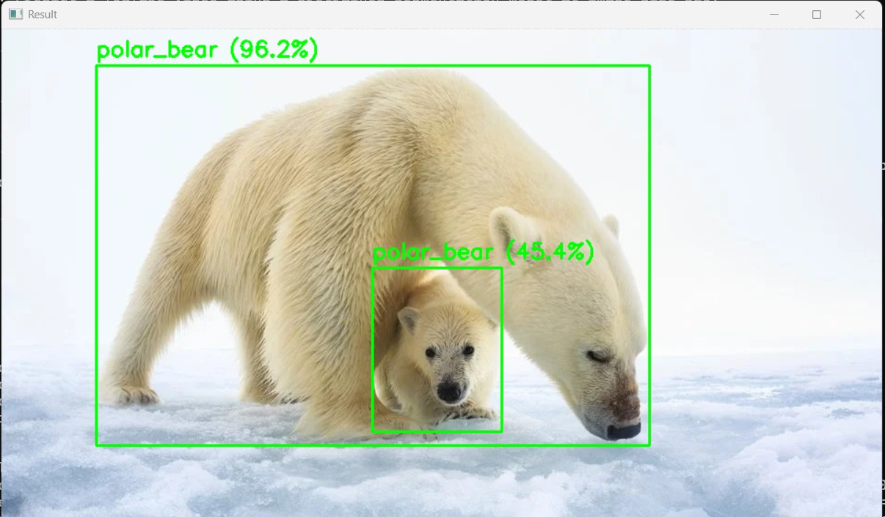
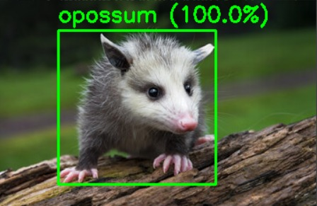
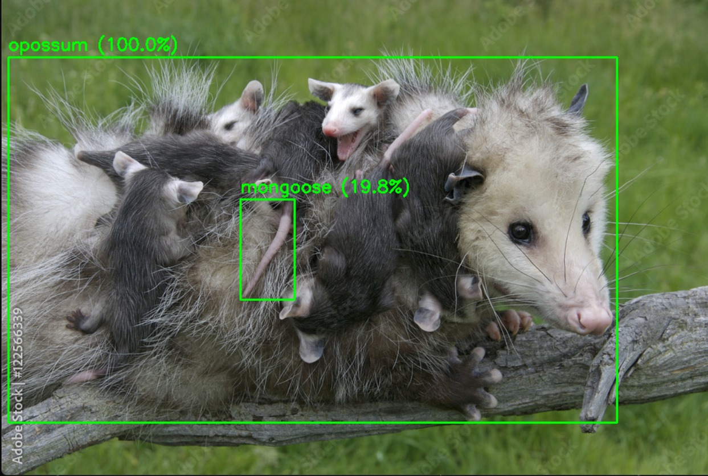
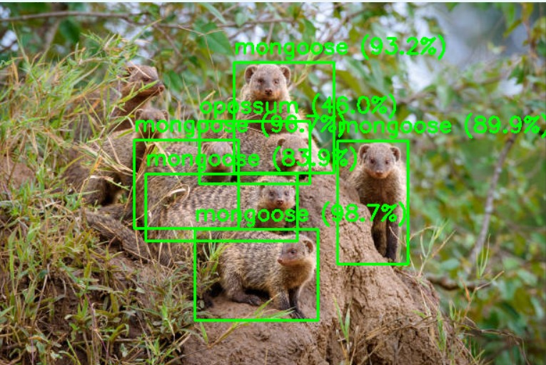

<div align="center">



<br/>

     [](LICENSE)

<br/>



<br/><br/>

[How it works](#how-it-works) | [Examples](#examples) | [Supported species](#supported-species) | [Quick start](#quick-start)

</div>

---

# Wildlife Classifier Pro v2: Detect Every Animal, Name Every Species

A two-stage computer-vision pipeline: **YOLOv8x** finds each animal and crops it, then a fine-tuned **EfficientNet-B4** classifies every crop with a confidence score — 52 species, ~91.5% accuracy.

## News

- [2026-10] **Command line for `predict.py`:** classify many images at once, save annotated copies with `--save`, hide weak guesses with `--min-conf`, and run headless with `--no-show`.
- [2026-04] **Pro v2 released:** YOLOv8x detection + EfficientNet-B4 classification across 52 species, succeeding the 3-class edge classifier.

<div align="center">

<br/>
<sub>Six mongooses, six detections, every one classified correctly (<code>--min-conf 50</code>).</sub>
</div>


---

## How it works



Why two stages? A whole-image classifier has to pick one label, even when a photo holds several
animals or one small animal in a big scene. Detecting first means each animal is classified on its
own tightly cropped region, at the classifier's full 380×380 input resolution.

| | |
|---|---|
| **Detector** | YOLOv8x (Ultralytics), confidence threshold 0.25 |
| **Classifier** | EfficientNet-B4, ImageNet-pretrained, fine-tuned with transfer learning |
| **Input** | 380 × 380 RGB crops |
| **Classes** | 52 species |
| **Accuracy** | ~91.5% classification accuracy |
| **Multi-animal** | Every detection gets its own box, label and confidence |

## Examples

<p align="center">
  
  
</p>
<p align="center">
  
  
</p>

## Supported species

<details>
<summary><b>All 52 classes</b></summary>
<br/>

| | | | |
|---|---|---|---|
| alligator | alpaca | anteater | antelope |
| arctic fox | armadillo | axis deer | baboon |
| badger | beaver | bison | black bear |
| boar | bobcat | brown bear | buffalo |
| cat | coyote | crocodile | dog |
| donkey | elephant | elk | fallow deer |
| gray fox | groundhog | hippopotamus | horse |
| jackal | koala | lynx | mongoose |
| moose | mountain goat | mountain lion | opossum |
| otter | pig | polar bear | porcupine |
| rabbit | raccoon | red fox | reindeer |
| sika deer | skunk | squirrel | sugar glider |
| weasel | wolf | wombat | yak |

</details>

## Quick start

The model weights (`best_model_v2.pt`, `yolov8x.pt`) are stored with Git LFS, so install
[Git LFS](https://git-lfs.com) before cloning.

```bash
git lfs install
git clone https://github.com/Xenomorph27/wildlife-classifier-prov2.git
cd wildlife-classifier-prov2
pip install -r requirements.txt
```

```bash
# classify the bundled test image and open a preview window
python classifier-version-pro-v2/predict.py

# your own images: save annotated copies, skip the window, hide low-confidence guesses
python classifier-version-pro-v2/predict.py photo1.jpg photo2.jpg --save results/ --no-show --min-conf 50
```

| Option | |
|---|---|
| `images …` | One or more image files (default: `test.jpg`) |
| `--save DIR` | Write annotated images to `DIR` |
| `--min-conf PCT` | Hide predictions below this confidence, 0–100 |
| `--no-show` | Don't open the OpenCV preview window |

Runs on CPU out of the box and uses CUDA automatically when available.

## Project structure

```
classifier-version-pro-v2/
├── predict.py          # detection + classification pipeline (CLI)
├── best_model_v2.pt    # fine-tuned EfficientNet-B4 weights (Git LFS)
├── yolov8x.pt          # YOLOv8x detector weights (Git LFS)
├── test.jpg            # sample input
└── example_images/     # sample outputs
docs/results/           # README showcase output
```

## Related

[**edge-wildlife-classifier**](https://github.com/Xenomorph27/edge-wildlife-classifier) — the lightweight
predecessor: a 3-class ResNet18 for live webcam inference on edge hardware.

## License

[MIT](LICENSE) © Barnak Roy Nandy
